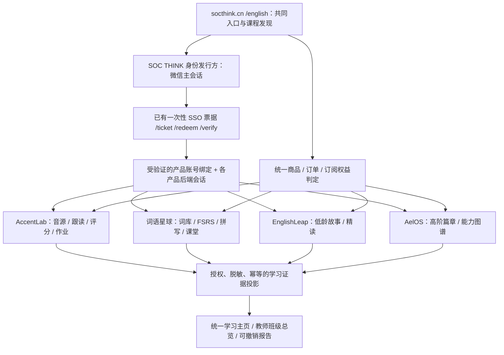

# 英文跃迁舱：五仓库全链路审计与统一模块架构

**审计日期**：2026-11-16；正式域名：`https://socthink.cn`。这是一份基于实际源码的工程收敛决定，不是“统一界面就等于统一业务”的产品宣传。

## 1. 源码范围和证据

用 `scripts/audit_english_suite_sources.py` 对五个独立 Git 仓库的**已跟踪第一方源代码与 SQL**做静态索引；排除 `vendor/`、原始图书、前端静态内容、自动生成文件、二进制和依赖。首次执行合计 **1,948 份第一方代码/SQL**；单独检查了认证、权限、课堂、API、学习记录及发布路径的关键实现。静态扫描不是逐行人工审计，更不是生产全链路已经通过；审计必须可以重复执行并关联每个 Git SHA。

| 模块 | 来源/初审基线 | 代码/SQL数 | 当前实际职责、风险与代码依据 |
|---|---|---:|---|
| SOC THINK 主站 | `Kangaroo-Practice-Simulator` `f64319b` | 984 | Next.js 总入口、`src/lib/english-products.ts` 导航、`src/lib/parent-auth.ts` 微信账号、`src/lib/classroom-web-*.ts` 课堂授权及 `src/lib/billing-ledger.ts` 中央计费；主站账户仍涉及 `parents.json`，不能冒充已完成统一 PostgreSQL 用户库 |
| AccentLab 发音 | `AccentLab` 生产 `56945dfe`，不是仓库旧 `main` | 244 | Vue+Rust、录音与参考评分、教师作业；`frontend/src/services/socthinkWechat.ts` 已调用主站微信身份，课堂权限由主站校验；`FollowAlongV3BookDataView.vue` 是需保护的复杂 V3 页面 |
| 词语星球 | `VocabLearningPlatform` 主线 `4e97500` | 307 | Vue+Rust+PostgreSQL，自有 `backend/src/staff_auth.rs`、学生口令登录、机构与班级、FSRS/作业；与主站微信会话**尚未验证联邦闭环**，不得凭导航页上线状态判断真实 SSO 成功 |
| EnglishLeap 阅读 | `EnglishLeap` 主线 `adca481` | 44 | Rust+Vue 阅读与音频，`src/http_auth.rs` 使用 `ENGLISH_LEAP_LOCAL_AUTH_DEV=1` 才启用的本机实验认证；主站公开阅读入口与正式账户系统不能视为已互通 |
| AelOS | `aelos` 初审主线 `7fba914`，安全修复见下文 | 369 | React+Node/Express+PostgreSQL，自有 `api/services/authService.ts`、`adminAuthService.ts` 和内容/学习 API；2026-11-16 独立安全 PR #60 已修复旧 Cookie 角色绕过和固定凭据种子，**生产实例是否已升级需另验** |

主站公开目录和四个静态 App 在此次审计中可访问，但 HTTP 200 **不能**证明个别学生、家长、教师账户、支付、评测、数据库迁移已经统一。

## 2. 目标：统一平台内核 + 独立教学引擎（五仓库仍保留）

**不可违反的原则：** 一套品牌、入口、身份协议、授权规范、统计口径和发布规范；各引擎仍各自拥有自己的题库、课程、数据结构、音频和评分算法，不把它们复制进主站第二套数据库。一个微信账号与一个学生的第一阶段使用规则按现行课堂维持，不额外设计一个家长绑定多个孩子的复杂 UI。

## 3. 清理后单一的所有权边界

| 业务能力 | **唯一权威归属** | 子产品与主站的接口边界 | 禁止的重复建设 |
|---|---|---|---|
| 账号身份 | SOC THINK `parent-auth`；现有账号身份为微信主会话 | 只读身份核验；产品服务端兑换**一次性票据**得到各自 `soc_...` 匿名主体；账号绑定须双侧验证并可解绑 | 每个产品重新申请微信 AppID；把微信昵称/不同 App 的 openid 当统一 UID；前端存储主站会话密钥 |
| 产品目录、跳转 | `src/lib/english-products.ts` | 新版 `GET /api/english/catalog` 从唯一数组生成四个应用的能力、入口及**真实集成状态**；SSO 产品白名单也从它派生 | 四份应用登记表、旧域名硬编码为正式入口、重复的产品状态判断 |
| 用户与教师角色 | 主站授权 + 每产品经验证的资源 ACL | 平台所有者与教师身份分开，老师对具体班级资源授权仍由业务端验证；子产品本地登录在 SSO 验收前仍保留可撤销兼容路径 | 单凭前端 teacher/admin 字段授权；把学生账户直接升级为管理员 |
| 学生/班级 | 每个业务产品持有自己的学习者和班级资料 | `external_account_links`、`external_class_links` 提供可撤销关联；必须记录产品、租户、产品局部 ID、授权方式、验证证据 | 直接 `JOIN` 不同产品数据库、按同名孩子自动合班、旧成绩批量改归属 |
| 内容与版本 | 各教学引擎本地拥有、主站只索引可公开 metadata | `productId + contentRef + version`；素材源、版权/许可、模型/音源版本按来源追溯 | 把原文全文、音频、私有书籍上传中央目录成为新的未经授权副本 |
| 作业与评分 | 各产品后端 | 统一只读作业摘要与证据契约 `schemas/english-learning-event.v1.schema.json`；签名或服务端鉴权、幂等事件、经过授权后投影 | 不同算法分数直接相加平均；由主站重新评分或伪造已提交记录 |
| 收费与权益 | SOC THINK 现有支付账本（最终唯一） | 服务端核验 `account + capability + expiry`，另行验收退款和撤权；项目侧本地支付逻辑迁移后退役 | 同订单复制四份、浏览器 paid=true 标记、自动把个人账号变成购买者 |
| 视觉和交互 | 共同 design tokens；业务 UI 各自维护 | 跨 React/Vue **共享 CSS tokens、字号尺度、响应式和组件行为测试**，不是共享一个绑死框架的组件文件 | 每产品独立品牌色或新增 `v56.css` 覆盖层；无回归修改已认可 V3 |
| 发布与回滚 | 各仓库独立发布，主站记录活跃指针 | 每应用发布声明：`productId/sourceSha/assetHash/apiVersion/databaseRevision/rollbackTarget`；回滚与其他产品独立 | 从旧默认分支覆盖生产功能、所有应用同时重启、未经 HTTP/API 和手机验收便宣告全站就绪 |

## 4. 真实问题优先顺序

### P0：认证与运行隔离（最先处理）

1. **AelOS 已合并 PR #60**：生产 `requireLocalOrAuth`、`requireRole` 不再信任未经验证的客户端 `userId`/`userRole` Cookie；支持独立有效 `admin_auth_token`。固定演示账号默认值不能再触发生产登录或种子创建。该 PR 在本地跑过 48 套/499 项测试、构建通过；**还需核查生产已升级与历史账号的凭据、未撤销会话**。已有加盐迁移/密码重置计划必须独立进行，禁止清理时毁掉真学生资料。
2. **SOC THINK**：身份主账当前部分存放 `parents.json`，应先规划 PostgreSQL 18.7 统一账号库的 `id + provider + binding` 迁移，使用一致性校验和可回退的影子读，不在没有备份、读写停机策略时直接替换线上数据。
3. **AelOS/词语星球/EnglishLeap**：产品自有登录必须被明确列为**未完成统一微信接入**；旧登录允许继续保护已存在数据，待 SSO 的新增用户/账号绑定、退出/到期/跨账号隔离真实通过后再逐项关停，不能一夜间直接删除旧表。

### P1：同一课堂与学习证据的联动

1. 主站已有 `src/app/api/english/sso/ticket|redeem|verify/route.ts` 和 `english-sso-ticket.ts`；它们是可复用的中央身份协议，但**没有证据证明四个产品后端均已完成真实兑换及一致的账号绑定**。必须逐产品完成而非新建另一套 SSO。
2. 词语星球和 AccentLab 均有班级、作业、已入班人数；先建立只读的跨产品关联表及一个服务端**教学待办摘要**，不合并产品的原始成绩/题库。学生姓名不是账号绑定证据。
3. 先建统一用户“**我的课程 / 今天要学什么**”入口：游客先看免费内容；已授权教师直接看真实班级；学生从微信作业链接直达作业；完成登录后回到原任务。不要求使用者选懂底层服务。
4. 统一学习事件信封仅为服务端内部规范，不自动启用收集：主站只保存经明确授权的最小统计投影，原声、答卷、儿童资料保留在各产品受保护的数据域。撤销授权后停止跨产品汇总；`eventId` + `productId` + `productEventId` 去重。

### P2：内部代码体积和开发流程

1. AccentLab 清理版 CSS 已从 23 份收敛到 14 份，仍存在大体积 V3 教练组件；只在可视化与评分回归后按音源、录音、评分、口型、老师作业**划分接口**，不要为漂亮目录机械拆功能。
2. AelOS `api/services/contentLibrary.ts` 超过 160KB；`vendor/index-tts` 与 `vendor/index-tts-backup` 两棵大型备份目录需做依赖关系与资产一致性审计，未验证生产服务使用路径前不直接删除。
3. SOC THINK `src/app/globals.css` 超过 100KB；应按英语、数学、账户和后台页面拆局部 tokens/styles，并建立 `390/768/1440px` 基线视觉测试，防止从全局 CSS 一改影响全部产品。
4. 词语星球多个历史工作区不等于多个正式产品；后续只从受保护主线发布，按 PR 清理不再使用的分支/测试预览。绝对不要对不明 provenance 的部署应用从任意旧 `main` 强推覆盖。

## 5. 版本化接口与验收

- **已实现**：`GET /api/english/catalog`，服务目录 `schemaVersion=1`，四条产品记录的 `id/capability/entry/authMode/classroomMode/federationStatus` 都来自**同一份** `ENGLISH_PRODUCTS`。该接口只包含公开元信息，不含账号、订单、儿童信息；App 不得据此推断授权成功。
- **已有但未全联通**：`POST /api/english/sso/ticket`、`redeem`、`verify`。中央 Cookie 校验、每产品独立服务端密钥、一次性短票；接入子应用必须补真实账号映射、请求重放、同步登出及退出后私有页面禁入测试。
- **仅定义数据契约、没有假装上线**：`schemas/english-learning-event.v1.schema.json`。指标必须明确 `name + scale + modelVersion`，发音精度、词汇记忆、阅读理解不能混为一个未经校准的综合分。
- **可重复全仓审计**：`scripts/audit_english_suite_sources.py`，传入五个独立工作区路径生成同一格式、带 SHA 的代码规模与安全模块盘点；不联网，不读取生产凭据或学生记录。

## 6. 迁移批次（每批独立发布，不同时升级五个产品）

| 批次 | 交付内容 | 生产验收标准 |
|---|---|---|
| A · 本轮 | 五仓库源码归属盘点、中央目录 API/同一 SSO 产品允许列表、AelOS 独立权限加固 PR | 代码测试/构建、真实入口可达；**P0 权限代码的正式部署需另有回执** |
| B · 词语星球 | 后端从 SOC THINK 票据兑换并绑定已有受验证的学员主体；教师授权继续依业务数据判断 | 两个真实隔离账号、双设备、入班/撤权、登出失效；旧用户不丢班级与单词记忆历史 |
| C · AelOS | 旧登录逐步过渡为 SOC THINK SSO，保持独立管理员的真实权限，整理 SHA-256 到加盐哈希 | 旧学生登录后正确绑定、超管/教师无越权、报告及图书馆无断链、已知演示凭据无效 |
| D · EnglishLeap | 阅读访问与账号记录分层，隔离测试型 `el_session_dev`；公开阅读先保持可用 | 免费阅读不强制登录，保存进度才需真实微信；一微信一学生，跨账号不会共享私有文章与记录 |
| E · 教师/学习总览 | 主站基于经授权事件摘要显示四产品“我的课程、今天任务、教师待批改” | 单任务一键直达；退出后一切私有内容不可访问；教师仅见自己班学生，原始录音仍在产品内 |
| F · 视觉与商业 | 统一 tokens、一个收银台、权益缓存与撤销、一套发布仪表盘 | 手机/桌面回归、评分延迟和功能不降级、真实授权/到期/退款验证、独立快速回退 |

**禁止跳过：** 外部账号初次映射、真实会话签发、既有账号/学习记录归属、家长授权与孩子隐私、账务退款/撤销、发布原始回执。`/english` 的漂亮页面只证明导航统一，不能替代这些测试。
